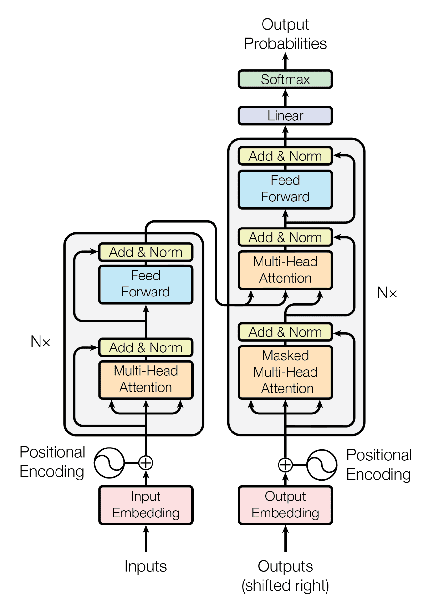
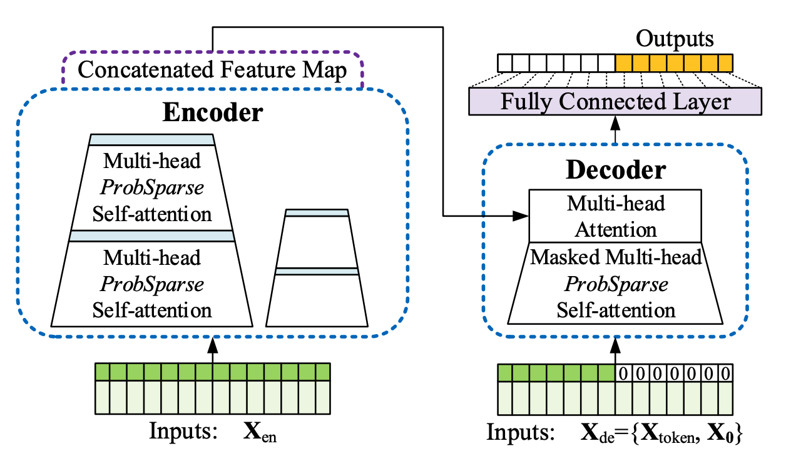
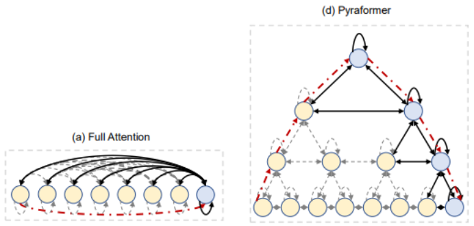

# TradeAI: Avanzando en Sistemas de Trading Algorítmico con Deep Learning para Datos de Criptomonedas

## Introducción

La integración de métodos de aprendizaje profundo en sistemas de trading algorítmico está revolucionando la industria financiera. Ha abierto capacidades de análisis y toma de decisiones sofisticadas que antes estaban limitadas a inversores institucionales, haciéndolas accesibles a los inversores minoristas. Sin embargo, la aplicación del aprendizaje profundo en el trading de frecuencia media (1-30 segundos), especialmente en el mercado de criptomonedas, sigue siendo en gran medida inexplorada.

Este proyecto de investigación pretende cerrar esta brecha investigando la viabilidad y efectividad de integrar métodos de aprendizaje profundo en un sistema de trading algorítmico diseñado específicamente para el comercio de criptomonedas. [Aquí el informe completo](docs/documents/Final_Report.pdf)

## Objetivos de Investigación

- Explorar la aplicación de métodos de aprendizaje profundo en el trading de criptomonedas de frecuencia media.
- Desarrollar un sistema de trading algorítmico full-stack integral.
- Investigar arquitecturas de transformadores novedosas, incluyendo Informer, Pyraformer y un transformador original mejorado, para la predicción de precios de criptomonedas.
- Comparar el rendimiento de estos modelos de transformadores con modelos ARIMA tradicionales, particularmente al operar con conjuntos de datos más grandes.
- Integrar señales predictivas de estos modelos en un marco de Aprendizaje por Refuerzo Profundo (DRL) para una generación de órdenes y toma de decisiones efectiva.

## Hallazgos de la Investigación
Este estudio exploró la viabilidad de desarrollar un sistema de trading algorítmico full-stack capaz de ejecutar estrategias de trading basadas en aprendizaje profundo sobre datos de libro de órdenes de límite de criptomonedas.

- Los modelos de transformadores (Informer, Pyraformer, transformador original mejorado) superaron a los modelos ARIMA tradicionales en la captura de patrones intrincados en los datos de precios de criptomonedas.
- El modelo Pyraformer exhibió el mejor rendimiento, mostrando una precisión predictiva superior y tiempos de entrenamiento e inferencia más cortos.
- La integración de señales predictivas de estos modelos en un marco de Aprendizaje por Refuerzo Profundo (DRL) mejoró las capacidades de generación de órdenes y toma de decisiones.
- El sistema de trading algorítmico mostró resultados prometedores, con potencial para un afinamiento y mejora adicionales.

## Métodos
Los modelos predictivos son una herramienta poderosa para predecir con precisión eventos o resultados futuros basándose en datos históricos. Con la creciente disponibilidad de conjuntos de datos grandes y complejos, las técnicas avanzadas de aprendizaje automático se han vuelto esenciales para extraer información significativa y tomar decisiones informadas. Este estudio realizó una revisión extensa de la literatura para identificar una variedad de modelos predictivos, incluyendo el Transformer, Informer y Pyraformer. Estos modelos han demostrado un rendimiento impresionante en el aprendizaje de patrones complejos a partir de datos históricos y en la predicción precisa de tendencias futuras
### Modelos Transformer

#### Transformer

El Transformer es una arquitectura fundamental de aprendizaje profundo que ha revolucionado el procesamiento del lenguaje natural y el análisis de series temporales. En este estudio, exploramos su aplicación a la predicción de precios de criptomonedas. Los componentes centrales del Transformer, como la autoatención y la atención multi-cabeza, le permiten capturar patrones complejos en los datos históricos.



#### Informer

Informer es una arquitectura de transformador para series temporales especializada y diseñada explícitamente para tareas de predicción. Aborda algunas de las limitaciones del Transformer original al manejar secuencias largas de datos. Informer introduce técnicas innovadoras de codificación posicional y destilación de autoatención para mejorar su rendimiento en la captura de dependencias temporales.



#### Pyraformer

Pyraformer es un modelo Transformer novedoso basado en atención piramidal, adaptado para datos de series temporales. Su objetivo es capturar eficientemente dependencias de largo alcance manteniendo una baja complejidad computacional. Pyraformer introduce el Módulo de Construcción a Escala Más Gruesa (CSCM) y el Módulo de Atención Piramidal (PAM) para lograr estos objetivos.



## Ideas para Trabajo Futuro

En el ámbito del trabajo futuro, se pueden explorar varias áreas clave para seguir mejorando el rendimiento y las capacidades de los sistemas de trading algorítmico:

- Explorar la influencia del tamaño del conjunto de datos en el rendimiento de los modelos de transformadores, incluyendo conjuntos más grandes que abarcan duraciones de 3 o 7 días.
- Investigar la efectividad de los transformadores de series temporales en la predicción de datos tanto de alta frecuencia como de baja frecuencia para comprender su escalabilidad.
- Realizar un análisis exhaustivo entre los modelos de transformadores y los modelos LSTM de última generación para determinar sus fortalezas y debilidades.
- Implementar técnicas de análisis de sentimientos para enriquecer los modelos predictivos mediante la integración de información contextual de redes sociales y noticias.
- Experimentar con diferentes arquitecturas de redes neuronales, como redes neuronales convolucionales (CNN) y redes neuronales recurrentes (RNN), para mejorar las capacidades de predicción.
- Mejorar aún más la simulación de mercado para entornos de trading más precisos.
- Preparar el sistema de trading para el trading en vivo mediante el manejo de flujos de datos de mercado en tiempo real y la optimización de los módulos de ejecución.
- Explorar el potencial de evolucionar el sistema hacia un paradigma de trading algorítmico como servicio, particularmente si progresa hacia una clasificación de nivel 2 de MLOps y establece reglas de escalabilidad de microservicios.

Estas direcciones para futuras investigaciones destacan el potencial para una innovación y mejora continuas en el trading algorítmico de criptomonedas.


## Configuración

- Comandos de configuración

  ```
  conda create -n tradeai python=3.8 -y

  conda activate tradeai

  pip install --upgrade pip setuptools wheel

  pip install -r requirements.txt

  sudo apt-get install git-lfs (linux)

  brew install git-lfs (homebrew)

  choco install git-lfs (microsoft)
  ```

- Ejecutar TradeAI (localmente y en contenedor)

  ```
  ./run_locally.sh
  ```

- Ejecutar Cliente (conectándose a TradeAI local)

  ```
  npm install

  npm start
  ```

- Ejecutar TradeAI (en Azure; requisitos adicionales: docker, docker-compose, az)

  ```
  ./run_in_azure.sh
  ```

- Cómo usar DVC para gestionar datos

  1. Solicitar ser agregado al repositorio remoto de DVC

  2. dvc pull: debería solicitar iniciar sesión en la cuenta de Google.

  3. Modificar datos

  4. dvc add [data_file]

  5. Confirmar cambios en [data_file].csv.dvc a git

  6. dvc push
